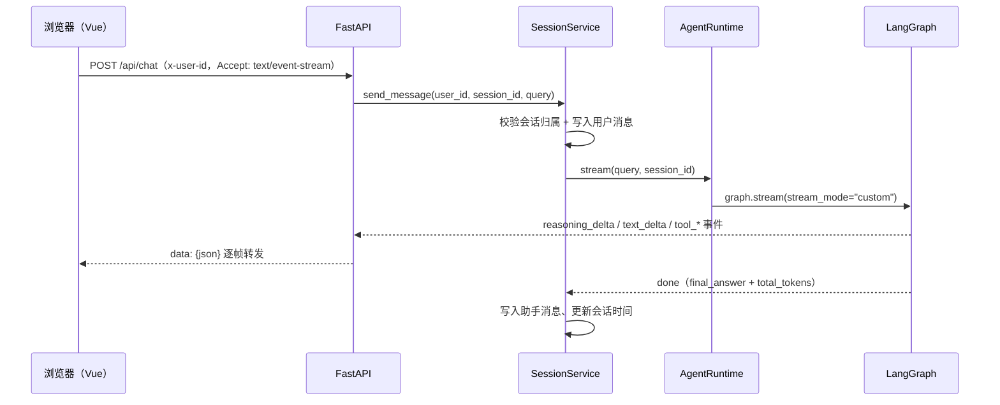
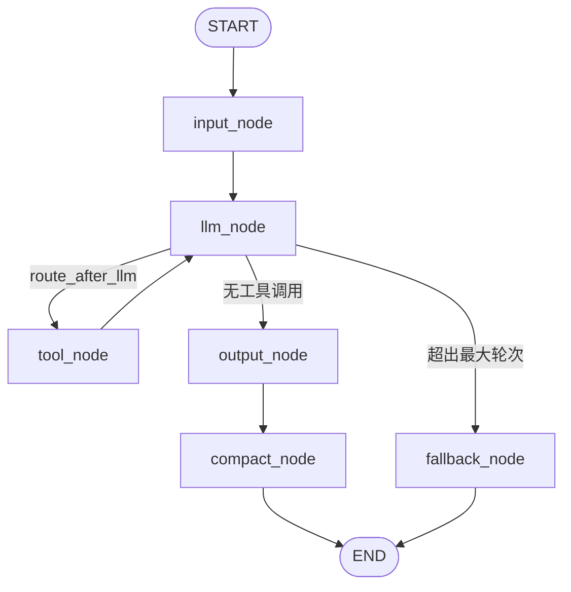

# 饭饭 · 江西师范大学校园助手（毕业设计）

基于 LangGraph 构建的校园智能助手：后端是 Agent + FastAPI 接口层，前端是 Vue 3 单页应用。支持多轮工具调用、流式输出、会话持久化、图片多模态输入与校园知识库检索。

## 功能特性

- **多轮 Agent 循环**：LangGraph `StateGraph` 编排，LLM 自主决定是否调用工具，带最大轮次限制与兜底总结
- **流式输出**：`stream_mode="custom"` 逐 token 推送，经 SSE 转发给浏览器，前端实时展示推理与回答
- **可插拔工具系统**：天气查询、联网搜索、校历查询、校园知识库检索，内置 JSON Schema 参数校验与类型检查
- **校历结构化查询**：教学周、节假日、补课、考试安排走 PostgreSQL 精确计算，不用向量检索
- **会话持久化**：基于 LangGraph PostgreSQL Checkpointer，支持中断恢复；删除会话时级联清理 checkpoint
- **历史压缩**：长对话按 token 占用自动折叠早期轮次为滚动摘要，完整历史仍保留给前端展示
- **多模态输入**：图片经服务端上传落盘后编码为 data URL 送模型，前端通过静态托管回显
- **多模型接入**：抽象 `BaseProvider` 接口，已接入阿里云 DashScope（Qwen）与 OpenAI
- **知识库管线**：MinerU 解析 PDF / Word / Excel，按标题栈切块，md5 去重入库
- **混合检索**：Milvus 稠密向量 + BM25 稀疏向量，RRF 融合后接重排模型，按分数阈值判定「有没有依据」
- **Web 前端**：会话分组与搜索、多会话并行的后台流式、Markdown 渲染、WebGL 液态玻璃背景

## 技术栈

| 类别 | 选型 |
| --- | --- |
| Agent 编排 | LangGraph |
| 模型 | DashScope（Qwen 对话 / embedding / reranker）、OpenAI |
| 接口层 | FastAPI + Uvicorn（SSE 流式） |
| 前端 | Vue 3 + Vite 6 + Element Plus + markdown-it / highlight.js |
| 会话存储 | PostgreSQL 16 + langgraph-checkpoint-postgres |
| 向量库 | Milvus 2.5（etcd / MinIO / Attu），稠密 + BM25 稀疏 |
| 文档解析 | MinerU |
| 联网检索 | Firecrawl |
| 前端动效 | WebGL 着色器（液态玻璃、粒子漂移） |
| 包管理 | uv（Python 3.13+）/ npm |
| 容器编排 | Docker Compose |

## 项目结构

```
Graduation-Project/
├── agent/                      # Agent 核心
│   ├── graph.py                # StateGraph 构建与编译
│   ├── nodes.py                # input / llm / tool / fallback / output / compact 节点
│   ├── routers.py              # llm 之后的条件路由
│   ├── runtime.py              # AgentRuntime 对外门面（stream / delete_thread）
│   ├── state.py                # AgentInput / AgentState / OutputState 状态定义
│   ├── summarizer.py           # 历史压缩与兜底总结
│   └── tools/                  # 工具子系统
│       ├── base.py             # BaseTool 抽象基类
│       ├── registry.py         # 工具注册与 schema 校验
│       ├── executor.py         # 参数校验与工具执行
│       ├── weather.py          # get_weather 天气查询
│       ├── websearch.py        # websearch Firecrawl 联网搜索
│       ├── academic_calendar.py    # academic_calendar 校历查询（PostgreSQL）
│       └── knowledge_search.py     # knowledge_search 校园知识库检索
├── api/                        # HTTP 接口层
│   ├── main.py                 # FastAPI 应用：会话 CRUD、SSE 对话、图片上传
│   └── demo.py                 # FastAPI 练习示例，与业务无关
├── models/                     # 模型 Provider 抽象与实现
│   ├── base.py                 # BaseProvider / ChatMessage / ChatResponse / ToolCall
│   ├── dashscope/              # Qwen 对话、embedding、reranker
│   └── openai/                 # OpenAI 对话
├── knowledge/                  # 知识库入库管线
│   ├── mineru_parser.py        # MinerU 云端解析（落盘 full.md / content_list.json）
│   ├── chunking.py             # 按标题栈切块，相邻块重叠
│   └── server.py               # KnowledgeService：解析入库、混合检索与重排
├── milvus/                     # Milvus 客户端封装
│   └── client.py               # 知识块写入、稠密 + BM25 混合检索
├── session/                    # 会话领域层
│   ├── models.py               # Session / Message 数据模型
│   ├── ports.py                # AgentPort / SessionRepository 协议
│   ├── repository.py           # PostgreSQL 实现，幂等建表
│   └── service.py              # 会话生命周期 + Agent 事件流 + 落库
├── checkpoint/                 # PostgreSQL Checkpointer 上下文管理
├── prompts/                    # system_prompt.md 等提示词
├── config/calendar/            # 校历 YAML（2026 春/秋）
├── scripts/                    # 运维脚本
│   ├── md_to_milvus.py         # 把 data/*.md 切块入库
│   ├── rebuild_knowledge.py    # 丢弃旧集合并全量重建
│   ├── import_academic_calendar.py   # 校历 YAML → PostgreSQL
│   └── academic_calendar_schema.sql  # 校历表结构
├── utils/                      # 日志、图片编码、提示词加载、md 转换等
├── frontend/                   # Vue 3 前端
│   ├── src/
│   │   ├── App.vue             # 单页主界面：会话列表、消息流、输入区
│   │   ├── api/                # client.js / sessions.js / chat.js（SSE 解析）
│   │   ├── components/         # BrandLogo / GlassLayer / ParticleDrift
│   │   ├── glass/              # 液态玻璃 WebGL 着色器与组合式函数
│   │   ├── directives/         # glassTilt 交互指令
│   │   └── utils/markdown.js   # markdown-it + highlight.js（禁用原始 HTML）
│   ├── vite.config.js          # /api、/uploads 代理到 8002
│   └── package.json
├── docker-compose.yml          # etcd / MinIO / Milvus / Attu / PostgreSQL
└── pyproject.toml
```

## 运行流程

前端只跟 `api/` 打交道，`api/` 把请求交给 `SessionService`，后者负责校验与落库，再驱动 `AgentRuntime`：



SSE 事件类型：`run_started`、`reasoning_delta`、`text_delta`、`tool_call`、`tool_started`、`tool_finished`、`done`、`run_failed`。

图内节点流转：



- `input_node` 把用户 query 封装为 `ChatMessage`，补齐历史中悬空的 `tool_calls`，初始化轮次与超时
- `llm_node` 流式调用模型，通过 `get_stream_writer()` 推送增量事件；窗口 = 系统消息（含摘要）+ `messages[summary_upto:]`
- `route_after_llm` 决定：无工具调用 → 输出；有调用且未超轮次 → 执行工具后回到 `llm_node`；超轮次 → 兜底总结
- `compact_node` 在输出后检查本轮输入 token，超过上下文窗口约 60% 时把早期轮次折叠成滚动摘要
- `fallback_node` 无后继节点，LangGraph 在图无出边时自动收尾

## 快速开始

### 1. 启动依赖服务

```bash
docker compose up -d
```

会拉起 etcd、MinIO（仅容器内网）、Milvus（19530 / 9091）、Attu（8000）、PostgreSQL（5432）。

### 2. 配置环境变量

复制 `.env.example` 为 `.env`，填入自己的密钥。

| 变量 | 用途 |
| --- | --- |
| `DASHSCOPE_API_KEY` | Qwen 对话、embedding、reranker |
| `OPENAI_API_KEY` | OpenAI Provider（可选） |
| `FIRECRAWL_API_KEY` / `FIRECRAWL_BASE_URL` | 联网搜索工具 |
| `LANGGRAPH_POSTGRES_URI` | 会话与 checkpoint 存储，缺省即启动失败 |
| `MINERU_API_KEY` | 文档解析入库 |

### 3. 安装后端依赖

```bash
uv sync
# FastAPI / Uvicorn / python-multipart 目前尚未写入 pyproject.toml，需要额外安装
uv add fastapi "uvicorn[standard]" python-multipart
```

### 4. 启动后端

```bash
uv run uvicorn api.main:app --host 127.0.0.1 --port 8002 --reload
```

首次启动会自动创建 LangGraph 检查点表与会话表（幂等）。启动时会校验 `LANGGRAPH_POSTGRES_URI`，数据库不通会直接报错退出。

不要用 `python api/main.py` 启动：脚本方式运行会把 `api/` 而非项目根放进 `sys.path`，导致 `ModuleNotFoundError: No module named 'models'`。

### 5. 启动前端

```bash
cd frontend
npm install
npm run dev
```

打开 http://127.0.0.1:5173 。Vite 已把 `/api` 与 `/uploads` 代理到 `127.0.0.1:8002`，无需额外配置跨域。

## HTTP 接口

除上传外均为 JSON；所有接口通过 `x-user-id` 请求头识别用户，缺失返回 401。这是开发期的临时身份方案，**不是真实鉴权**。

| 方法 | 路径 | 说明 |
| --- | --- | --- |
| GET | `/api/sessions` | 列出当前用户的会话 |
| POST | `/api/sessions` | 新建会话；已有空会话时直接复用，避免越点越多 |
| GET | `/api/sessions/{id}/messages` | 拉取历史消息；会话不属于该用户时 404 |
| DELETE | `/api/sessions/{id}` | 删除会话：先删 checkpoint 再删业务行 |
| POST | `/api/chat` | SSE 流式对话，请求体 `{session_id, text, images, reasoning}` |
| POST | `/api/upload` | 上传图片，仅 jpeg/png/gif/webp，上限 10MB，文件名由服务端 uuid 生成 |
| GET | `/uploads/{name}` | 静态托管上传目录，供前端 `` 回显 |

`/api/chat` 收到的 `images` 是上传接口返回的相对路径（`data/uploads/xxx.png`）。服务端会 `resolve()` 后校验必须落在上传目录内，再编码成 data URL 送模型；落库和回显用 `/uploads/xxx.png`。两个地址分开是因为模型要能读文件、浏览器要能直接加载。

## 知识库入库

```bash
# 把 data/*.md 切块写入 Milvus（--dry-run 只统计不写库）
python scripts/md_to_milvus.py --dry-run
python scripts/md_to_milvus.py

# 旧集合缺少 BM25 稀疏字段，无法原地升级，需要重建（会重新解析与嵌入）
python scripts/rebuild_knowledge.py          # 只预览
python scripts/rebuild_knowledge.py --yes    # 确认重建

# 校历 YAML 导入 PostgreSQL
python scripts/import_academic_calendar.py
```

入库按文件 md5 去重，重复执行只会跳过。检索侧用稠密 + BM25 两路召回，RRF 融合后交给重排模型，低于阈值的结果直接丢弃——「查不到依据」比「编一个」重要。

## 说明

- `.env` 中的密钥不会被提交，请参考 `.env.example` 自行配置
- `data/`、`logs/`、`test/`、`knowledge/parser_data/` 为本地样本、运行日志、调试脚本与解析产物，不纳入版本控制
- 上传目录 `data/uploads/` 在后端启动时自动创建，浏览器上传的图片同样不纳入版本控制
- 仓库内暂无自动化测试；计划把不含私有数据的单元测试放入 `tests/` 提交
- 首次运行时 `postgres_checkpointer` 会自动创建 LangGraph 检查点表，可重复调用
- 会话表通过 `setup()` 幂等建表与补列，旧库会按 `legacy_user_id` 回填归属
- `api/demo.py` 是 FastAPI 语法练习，与业务无关，可忽略

## License

本项目为本科毕业设计，仅供学习交流。
