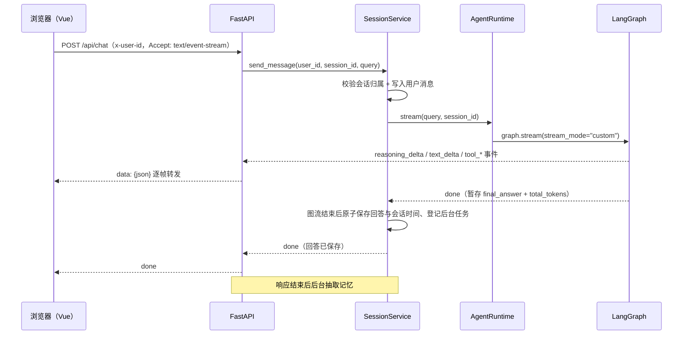

# 饭饭 · 江西师范大学校园助手（毕业设计）

基于 LangGraph 构建的校园智能助手：后端是 Agent + FastAPI 接口层，前端是 Vue 3 单页应用。支持多轮工具调用、流式输出、会话持久化、图片多模态输入与校园知识库检索。

## 当前基线与进度

2026-10-24 首轮整理文档和依赖时，修改前基线为 `3ba0f931250d2243e56c9b9eea8a7df7c2511f22`；该轮已提交为 `7e2d22f`。稳定性修复已提交为 `10ed576`；消息操作与来源保存以该版本为基线，并保留本地尚未提交的会话 `dot` 改动。当前功能说明反映工作区代码。

| 能力 | 当前状态 |
| --- | --- |
| Agent 工具循环、并行工具执行、轮次兜底、历史摘要 | 已有实现 |
| 流式聊天、图片输入、会话持久化及归属检查 | 已有实现 |
| 消息复制、原位重新生成、来源抽屉与历史来源快照 | 已有实现 |
| 结构切块、混合检索、重排、文档 md5 去重 | 已有实现 |
| 长期记忆抽取、注入、查看、编辑、删除 | 已有实现 |
| 知识库上传、任务状态、分页筛选、切片查看、删除、同步 | 已有实现 |
| PostgreSQL 业务连接池与 checkpoint 连接池 | 已有实现 |
| 真实登录、管理员权限、用户反馈、正式评测集与 RAGAS | 尚未形成完整实现 |

“已有实现”不代表已通过真实外部服务验收。已有技术验证记录、毕业设计计划和架构草稿的状态可能滞后，功能进度以当前代码为准。

首轮文档与依赖验证（2026-10-24）：

- `uv lock --check` 通过；原直接依赖约束保留，原锁文件中继续使用的包没有版本变化。
- Windows / Python 3.13.16 临时独立环境执行 `uv sync --locked` 成功，运行时依赖导入通过。新锁定的 Starlette 为 1.9.0，与现有 Conda 中的 1.8.0 不同；本轮未修改现有 Conda 环境。
- README 中的 15 个业务接口与路由定义一致；前端 package.json 与 package-lock.json 的直接依赖一致；52 个业务 Python 源文件语法解析通过。
- 尚未验收 Docker 服务启动、数据库连接、前端构建、真实聊天、文档解析、入库与检索效果；这些需按下方手动验收步骤继续确认。

### 稳定性修复与验证（第二轮，2026-10-24）

- 知识库初始化失败只尝试一次，普通聊天继续启动；检索工具返回不可用错误，知识库管理返回 503。恢复依赖后需重启服务，不自动重连。
- 单进程内共享会话运行锁，重复发送与生成中删除返回 409；不同会话可并行。响应头发送失败、未消费流、执行异常、断连均清理资源；同步执行未退出前不提前解锁。
- `done` 只在图执行结束且回答与会话时间原子保存后发出；失败只发送 `run_failed`。摘要压缩失败保留旧摘要，不影响正常回答；前端能识别缺少终止事件的断流。
- 记忆抽取在响应结束后由 BackgroundTasks 执行，同用户任务串行；请求连接先归还，模型抽取期间不占数据库连接，保存前重新去重。任务失败只记日志，异常退出后不恢复；正常 Uvicorn 关闭会等待响应后台任务，强制退出或配置的关闭超时仍可能中断任务。
- 入库校验空切片、嵌入数、写入数和强一致查询块数；只有完整结果进入 `ready`。上传通过数据库条件写入原子抢占，失败重试只清理该文件哈希的残留块。同步只清理缺失的 `ready` 登记，保留在途和失败记录，并与完成、删除操作互斥。
- 新增 `tests/`：44 项 Python 回归测试在 uv 临时环境和现有 Conda 环境均通过，8 项 Node 事件流测试通过。使用模拟模型、仓储及 FastAPI 测试客户端，SQL 事务边界与条件通过测试替身检查，未连接真实 PostgreSQL / Milvus 或调用付费 API。
- 前端构建：普通 `npm run build` 在本机因 esbuild 删除大输入临时文件被拒绝而失败；相同配置使用 esbuild 内置内存回退路径构建通过（1833 个模块）。未修改 Vite 配置或依赖源码；大 bundle 提示仍存在。
- 新增 AnyIO 的直接依赖声明，用于响应清理的取消屏蔽；沿用锁文件中已有版本，未新增测试框架。

### 消息操作、来源与历史保存（第三轮，2026-10-24）

- 每条用户消息在气泡右下方提供复制；AI 生成结束后在消息下方同一行靠左显示复制、重新生成和来源汇总，生成期间隐藏整组操作。按钮不显示线条边框，悬停时仅用淡背景突出，保留键盘焦点提示。AI 复制 Markdown 原文，纯图片消息复制图片链接；复制结果在按钮旁短暂反馈。
- 来源汇总按文档与网页计数，桌面打开右侧抽屉，窄屏打开底部面板。分组默认折叠，支持 Escape、键盘焦点循环和关闭后返回触发按钮；查看文档后“返回来源”恢复原会话消息与聊天滚动位置。
- 来源仅表示该轮成功工具调用返回的资料，不代表逐句引用。按分片标识或网页 URL 去重并随回答原子保存；不展示分数和哈希，不访问外部 favicon。网页只允许 HTTP/HTTPS 链接。
- 知识库保留命中分片的完整正文、章节与位置快照；只有明确为 PDF 的正整数页码显示为页码。“查看文档”跳转现有切片详情，按分片序号计算分页，并核对分片 ID 后高亮；列表同时高亮对应文档并标记“来源文档”，不在当前分页或筛选结果中的来源文档临时置顶展示，按文档哈希区分同名文件。直接点击顶部“知识库”则进入普通列表并清除来源定位和临时置顶。重新切片、文档删除或知识库不可用时，保留快照并说明当前文档无法可靠定位，不打开或下载原文件。
- 启动时通过现有 `setup()` 幂等添加 `messages.sources JSONB`、`messages.reply_to_message_id` 与 `sessions.context_revision`。旧 AI 消息按同会话最近的前置用户消息回填对应关系；旧来源保留 `NULL`，显示“历史回复未记录来源”，新回复无来源保存 `[]`，显示“暂无来源”。无法关联原问题的旧回复不可重新生成。无需重建 Milvus 或重新入库。
- 重新生成使用原问题及其之前的业务历史和原图，后续消息不进入本次输入。独立临时 checkpoint 隔离失败；成功后原子替换目标回复正文、来源和用量，保留消息 ID、排序和后续对话，并增加上下文修订号。失败恢复原回答；原图缺失时拒绝执行；不重复抽取长期记忆、不保存旧版本。
- 替换成功清理旧主 checkpoint，下一轮发现缺失或修订号不一致时从最新业务历史重建并清除旧摘要；清理失败记录日志，修订号检查仍阻止使用旧状态。会话运行锁沿用单进程限制。
- 验证：63 项 Python 回归、13 项 Node 测试通过；真实 Chromium 使用模拟接口检查了复制反馈、混合来源、跨分页定位、历史恢复、文档删除、重新切片和知识库不可用、重新生成成功与失败、桌面/390px 窄屏、键盘焦点、滚动恢复及三种 `dot` 状态。未调用付费模型，未连接真实 PostgreSQL / Milvus。
- 构建：常规 `npm run build` 仍遇到本机 esbuild 大输入临时文件删除权限错误；不改配置或依赖源码，临时使用 esbuild 内置内存回退路径后构建通过（1839 个模块）。大 bundle 提示仍存在。真实数据库补列/回填、业务事务、Milvus 分片标识及真实模型链路需单独验收。本轮不自动提交或推送。

### 等待体验优化（第四轮，2026-10-24）

- 回复位置用真实状态行代替三个等待圆点：发送、服务器确认、工具查询、正文生成与最终保存。只按已收到的事件变化，不显示虚构百分比、倒计时或完整内部推理。侧栏“工作流”改为“本轮进展”，普通聊天不补造检索步骤。
- 按 `tool_call_id` 独立跟踪并行及重复工具调用，显示中文名称、返回或失败状态；默认显示当前活动与最近完成项，完整记录按需展开，并在侧栏内部滚动。回复旁也可折叠查看，窄屏无需依赖右侧面板；新增提示支持键盘操作及减少动态效果设置。
- 连续 20 秒没有新事件时提示“暂未收到新内容，仍在等待服务器响应”；已移除两处重复的下一问引导文案。阈值是首轮试验参数，不代表预计完成时间，不自动判定失败或重试；真实事件到来后刷新提示。“回到最新”仅显示向下箭头，保留悬停说明和无障碍名称。
- 生成时输入框继续可编辑，同会话发送仍禁用；文字与图片草稿按会话保存在当前页面内存中，切换会话可恢复，上传过程也绑定原草稿。完成回答不会清空下一问，草稿不会自动发送；刷新页面不保留草稿。异常断流结束加载，未保存回复提供“重新填写问题”，已有草稿不会被覆盖。
- 只有接近消息底部时才跟随输出，向上阅读后暂停；切换会话保留阅读位置，“回到最新”恢复跟随。输入区高度或进展提示变化时，仅在跟随模式下调整滚动。重新生成等待新正文期间保留旧回答，第一段新正文到来后再替换展示，失败恢复旧内容，不主动滚动到旧回复。
- 本标签页的 `sessionStorage` 中，`fanfan:run-measurements` 保留最近 100 次运行的服务器确认、首段非空文本事件、总耗时、最长无事件间隔、工具次数与结果状态；不保存问题、回答、工具参数或用户标识，也不发送遥测请求。可在浏览器控制台执行 `JSON.parse(sessionStorage.getItem('fanfan:run-measurements') || '[]')` 查看；这些是客户端接收事件时间，不等于模型纯推理时间或首段正文绘制时间。
- 验证：63 项 Python、19 项 Node 测试通过；来源/重新生成浏览器回归和逐段 SSE 等待体验回归均通过，覆盖并行工具、长等待、草稿和异步图片隔离、阅读位置、恢复跟随、异常断流、重试入口、旧回答保留、长记录、窄屏内联进展、键盘及减少动态效果。窄屏聊天检查使用收起侧栏后的现有布局；未将其表述为整站移动端改版。
- 本轮没有调用付费模型，也没有进行真实用户等待感测试；主观等待改善和真实首字延迟仍需后续测量。常规构建继续受本机已有 esbuild 临时文件删除权限问题影响，内置内存回退构建通过（1842 个模块），未修改依赖源码或 Vite 配置。本轮不自动提交或推送。

## 功能特性

- **多轮 Agent 循环**：LangGraph `StateGraph` 编排，LLM 自主决定是否调用工具，带最大轮次限制与兜底总结
- **流式输出**：`stream_mode="custom"` 推送增量事件，经 SSE 转发给浏览器；聊天页显示回答、当前工具名称及底部来源汇总，尚未展示推理增量
- **可插拔工具系统**：天气查询、联网搜索、校历查询、校园知识库检索，带工具 schema 检查和参数必填项、顶层类型检查；同一轮的多个工具可并行执行
- **校历结构化查询**：教学周、节假日、补课、校历中的考试日期区间走 PostgreSQL 查询；尚无按课程查询个人考试安排的工具
- **会话持久化**：基于 LangGraph PostgreSQL Checkpointer 保存图状态；删除会话时先清理 checkpoint，再删业务数据。客户端断流后的取消与恢复行为仍待验收
- **历史压缩**：长对话按 token 占用自动折叠早期轮次为滚动摘要，完整历史仍保留给前端展示
- **多模态输入**：图片经服务端上传落盘后编码为 data URL 送模型，前端通过静态托管回显
- **多模型接入**：抽象 `BaseProvider` 接口，已接入阿里云 DashScope（Qwen）与 OpenAI
- **长期记忆**：回答保存并结束响应后，后台抽取用户事实与偏好，后续对话注入已保存的记忆；前端可查看、编辑和删除。刚回答结束时记忆可能尚未生成，重新打开记忆面板刷新
- **知识库管线**：Web 上传支持 MD / TXT / PDF / DOC / DOCX，MD / TXT 本地转换，其余交给 MinerU 云 API；结构切块后按文本嵌入，以文件 md5 去重。图片块只使用图注和描述文字，不做图片向量入库
- **混合检索**：Milvus 稠密向量 + BM25 稀疏向量，RRF 融合后接重排模型；重排阈值当前为 0.3，需用真实评测集校准，不能据此保证答案有依据
- **知识库管理**：上传后台入库、阶段状态、失败记录、文档搜索与格式筛选、分页、切片查看、删除、Milvus 登记同步；服务重启后将中断任务标记为失败
- **Web 前端**：会话分组与搜索、多会话并行的后台流式、Markdown 渲染、WebGL 液态玻璃背景

## 技术栈

| 类别 | 选型 |
| --- | --- |
| Agent 编排 | LangGraph |
| 模型 | DashScope（Qwen 对话 / embedding / reranker）、OpenAI |
| 接口层 | FastAPI + Uvicorn（SSE 流式） |
| 前端 | Vue 3 + Vite 6 + Element Plus + markdown-it / highlight.js |
| 会话存储 | PostgreSQL 16 + langgraph-checkpoint-postgres |
| 向量库 | Milvus 2.5（etcd / MinIO / Attu），稠密 + BM25 稀疏 |
| 文档解析 | MinerU |
| 联网检索 | Firecrawl |
| 前端动效 | WebGL 着色器（液态玻璃、粒子漂移） |
| 包管理 | uv（Python 3.13+）/ npm |
| 容器编排 | Docker Compose |

## 项目结构

```
Graduation-Project/
├── agent/                      # Agent 核心
│   ├── graph.py                # StateGraph 构建与编译
│   ├── nodes.py                # input / llm / tool / fallback / output / compact 节点
│   ├── routers.py              # llm 之后的条件路由
│   ├── runtime.py              # AgentRuntime 对外门面（stream / delete_thread）
│   ├── state.py                # AgentInput / AgentState / OutputState 状态定义
│   ├── summarizer.py           # 历史压缩与兜底总结
│   ├── memory.py               # 用户长期记忆抽取
│   └── tools/                  # 工具子系统
│       ├── base.py             # BaseTool 抽象基类
│       ├── registry.py         # 工具注册与 schema 校验
│       ├── executor.py         # 参数校验与工具执行
│       ├── weather.py          # get_weather 天气查询
│       ├── websearch.py        # websearch Firecrawl 联网搜索
│       ├── academic_calendar.py    # academic_calendar 校历查询（PostgreSQL）
│       └── knowledge_search.py     # knowledge_search 校园知识库检索
├── api/                        # HTTP 接口层
│   └── main.py                 # FastAPI：会话、SSE、图片、记忆、知识库管理
├── models/                     # 模型 Provider 抽象与实现
│   ├── base.py                 # BaseProvider / ChatMessage / ChatResponse / ToolCall
│   ├── dashscope/              # Qwen 对话、embedding、reranker
│   └── openai/                 # OpenAI 对话
├── knowledge/                  # 知识库入库管线
│   ├── mineru_parser.py        # MinerU 云端解析（落盘 full.md / content_list.json）
│   ├── chunking.py             # 按标题栈切块，相邻块重叠
│   ├── documents.py            # PostgreSQL 文档登记与入库任务状态
│   └── server.py               # KnowledgeService：解析入库、混合检索与重排
├── milvus/                     # Milvus 客户端封装
│   └── client.py               # 知识块写入、稠密 + BM25 混合检索
├── session/                    # 会话领域层
│   ├── models.py               # Session / Message / Memory 数据模型
│   ├── ports.py                # AgentPort / SessionRepository 协议
│   ├── repository.py           # PostgreSQL 实现，幂等建表
│   └── service.py              # 会话生命周期、Agent 事件流、落库与记忆抽取
├── checkpoint/                 # PostgreSQL Checkpointer 上下文管理
├── prompts/                    # system_prompt.md 等提示词
├── config/calendar/            # 校历 YAML（2026 春/秋）
├── scripts/                    # 运维脚本
│   ├── md_to_milvus.py         # 把 data/*.md 切块入库
│   ├── rebuild_knowledge.py    # 丢弃旧集合并全量重建
│   ├── import_academic_calendar.py   # 校历 YAML → PostgreSQL
│   └── academic_calendar_schema.sql  # 校历表结构
├── utils/                      # 日志、图片编码、提示词加载、md 转换等
├── frontend/                   # Vue 3 前端
│   ├── src/
│   │   ├── App.vue             # 单页主界面：会话列表、消息流、输入区
│   │   ├── api/                # 会话、SSE、记忆、知识库请求
│   │   ├── components/         # KnowledgePage、Logo、玻璃与粒子组件
│   │   ├── glass/              # 液态玻璃 WebGL 着色器与组合式函数
│   │   ├── directives/         # glassTilt 交互指令
│   │   └── utils/markdown.js   # markdown-it + highlight.js（禁用原始 HTML）
│   ├── vite.config.js          # /api、/uploads 代理到 8002
│   └── package.json
├── docker-compose.yml          # etcd / MinIO / Milvus / Attu / PostgreSQL
├── pyproject.toml              # 后端直接依赖
└── uv.lock                     # 后端依赖解析锁文件
```

## 运行流程

前端只跟 `api/` 打交道，`api/` 把请求交给 `SessionService`，后者负责校验与落库，再驱动 `AgentRuntime`：



SSE 事件类型：`run_started`、`reasoning_delta`、`text_delta`、`tool_call`、`tool_started`、`tool_finished`、`done`、`run_failed`。

图内节点流转：


- `input_node` 把用户 query 封装为 `ChatMessage`，补齐历史中悬空的 `tool_calls`，初始化轮次、起始时间与 timeout 状态；timeout 尚未形成整轮执行期限
- `llm_node` 流式调用模型，通过 `get_stream_writer()` 推送增量事件；窗口 = 系统消息（含摘要）+ `messages[summary_upto:]`
- `route_after_llm` 决定：无工具调用 → 输出；有调用且未超轮次 → 执行工具后回到 `llm_node`；超轮次 → 兜底总结
- `compact_node` 在输出后检查本轮输入 token，超过上下文窗口约 60% 时把早期轮次折叠成滚动摘要
- `fallback_node` 无后继节点，LangGraph 在图无出边时自动收尾

图内输出节点在历史压缩前产生的 `done` 会被会话层暂存，图流正常结束且回答成功落库后才发送给浏览器。浏览器收到 `done` 表示回答已保存，后台记忆抽取可能仍未完成。一个流只发送一个成功或失败终止事件。

## 快速开始

### 环境与目录

所有后端命令都在项目根目录 `Graduation-Project/` 执行。需要 Python 3.13+、uv、Node.js/npm 和可运行 Docker Compose 的 Docker 环境。

本机已检查到的开发环境为 Python 3.13.16（Conda `Graduation-Project`）、Node.js 24.15.0、npm 11.12.1。本轮补入的 FastAPI 0.143.1、Uvicorn 0.54.0、python-multipart 0.0.32 与该 Conda 环境已安装版本一致；保留其余直接依赖约束，不迁移现有 Conda 环境。

新环境推荐用 uv 创建项目独立的 `.venv`；不要在现有环境中直接执行批量升级。`data/`、已上传文件、数据库内容和 MinerU 解析产物未随仓库提供，克隆代码不会带来已有知识库数据。

### 1. 启动依赖服务

```bash
docker compose up -d
```

会拉起 etcd、MinIO（仅容器内网）、Milvus（19530 / 9091）、Attu（8000）、PostgreSQL（5432）。

### 2. 配置环境变量

首次配置时复制 `.env.example` 为 `.env`，填入自己的密钥；已有 `.env` 时手动对照新增变量，不要覆盖。

| 变量 | 用途 |
| --- | --- |
| `DASHSCOPE_API_KEY` | Qwen 对话、embedding、reranker |
| `OPENAI_API_KEY` | OpenAI Provider（可选） |
| `FIRECRAWL_API_KEY` | 联网搜索工具；缺失不阻断启动，但工具不能正常使用 |
| `LANGGRAPH_POSTGRES_URI` | 会话与 checkpoint 存储，缺省即启动失败 |
| `MILVUS_URI` / `MILVUS_USER` / `MILVUS_PASSWORD` | 默认 `http://localhost:19530` / `root` / `root`，对应当前 Compose |
| `MINERU_API_KEY` | 当前 KnowledgeService 初始化即要求配置；MD / TXT 入库虽跳过云端解析，也需要该配置 |
| `MINERU_BASE_URL` | 可选，留空使用 MinerU 默认 API 地址 |

普通聊天启动需要 PostgreSQL 和 DashScope 配置；完整知识库还需要 Milvus 与 MinerU。知识库初始化失败时，普通聊天仍可启动，知识库管理接口返回 503；检索工具会明确返回不可用错误。恢复依赖或补齐配置后需重启服务。

`FIRECRAWL_BASE_URL` 当前未被代码读取。Firecrawl 地址固定在 `agent/tools/websearch.py`。默认主对话模型为 `qwen3.8-flash`，摘要和记忆模型为 `qwen3.7-flash`；这些是代码配置值，可用性需在所用服务账户下验证。OpenAIProvider 需要手动切换，默认地址也应检查后再使用，当前不是自动故障切换方案。

### 3. 安装后端依赖

```bash
uv sync --locked --python 3.13
```

### 4. 启动后端

```bash
uv run uvicorn api.main:app --host 127.0.0.1 --port 8002 --reload
```

首次启动会创建 LangGraph 检查点表、会话/消息/记忆表和知识库登记表（幂等），并初始化或加载 Milvus 集合。启动时会校验 `LANGGRAPH_POSTGRES_URI`，数据库不通会直接报错退出。校历表和数据需额外执行下方导入脚本，启动后端不会自动导入校历。

不要用 `python api/main.py` 启动：脚本方式运行会把 `api/` 而非项目根放进 `sys.path`，导致 `ModuleNotFoundError: No module named 'models'`。

### 5. 启动前端

```bash
cd frontend
npm ci
npm run dev
```

打开 http://127.0.0.1:5173 。Vite 已把 `/api` 与 `/uploads` 代理到 `127.0.0.1:8002`，无需额外配置跨域。

### 6. 首次准备校历与知识库

在项目根目录执行 `uv run --locked python -m scripts.import_academic_calendar`，创建校历表并导入 `config/calendar/*.yaml`。重复执行会覆盖对应学期的事件，以 YAML 内容为准。

知识库可通过前端知识库页面上传，或使用下方脚本导入本地资料。空库不影响普通对话，但不能回答尚未收录的校园事实。

### 7. 手动验收

- 检查 `docker compose ps`，确认依赖服务已启动；打开后端 `/docs` 确认接口文档可访问。
- 新建会话并发送普通问题，检查流式回答；刷新页面确认历史仍在。
- 查询已导入校历范围内的周次或节假日，检查工具结果。
- 上传一份有正文的测试文档，等待 `ready`，核对切片，再提问其中内容；同时检查无依据问题的回答。
- 明确告诉助手一条长期偏好，等待后台抽取完成后重新打开记忆设置，测试查看、编辑、删除；流结束时不保证新记忆已经可见。

上述聊天、解析、向量化和记忆抽取会访问外部服务，可能产生 API 费用。真实服务验收需单独执行，本轮回归测试使用模拟依赖。

## HTTP 接口

上传使用 multipart，聊天响应使用 SSE，其余主要为 JSON。会话、聊天、图片上传、记忆接口通过 `x-user-id` 请求头识别用户，缺失返回 401；前端目前固定为 `user_001`。这是开发期临时身份方案，**不是真实鉴权**。知识库管理接口目前未接入用户及管理员权限；`/uploads` 为静态公开访问。当前运行说明按本地开发用途编写。

| 方法 | 路径 | 说明 |
| --- | --- | --- |
| GET | `/api/sessions` | 列出当前用户的会话 |
| POST | `/api/sessions` | 新建会话；已有空会话时直接复用，避免越点越多 |
| GET | `/api/sessions/{id}/messages` | 拉取历史消息；会话不属于该用户时 404 |
| DELETE | `/api/sessions/{id}` | 删除会话：先删 checkpoint 再删业务行；生成中返回 409 |
| POST | `/api/chat` | SSE 流式对话，请求体 `{session_id, text, images, reasoning}`；同会话重复运行返回 409 |
| POST | `/api/sessions/{id}/messages/{message_id}/regenerate` | 无请求体，返回同样的 SSE；只替换目标 AI 回复，生成中 409，目标或会话不存在 404，原问题或图片无法恢复 422 |
| POST | `/api/upload` | 上传图片，仅 jpeg/png/gif/webp，上限 10MB，文件名由服务端 uuid 生成 |
| GET | `/uploads/{name}` | 静态托管上传目录，供前端 `` 回显 |
| GET | `/api/memories` | 当前用户的长期记忆 |
| PUT | `/api/memories/{id}` | 编辑自己的记忆，请求体 `{content}` |
| DELETE | `/api/memories/{id}` | 删除自己的记忆 |
| GET | `/api/knowledge/documents` | 文档搜索、格式筛选、分页与排序 |
| GET | `/api/knowledge/documents/{file_md5}/chunks` | 查看文档切片 |
| POST | `/api/knowledge/upload` | 上传文档，返回 202 和 pending 状态，单文件上限 50MB |
| GET | `/api/knowledge/jobs/{file_md5}` | 查询入库状态和阶段 |
| DELETE | `/api/knowledge/documents/{file_md5}` | 删除文档及向量块，处理中返回 409 |
| POST | `/api/knowledge/sync` | 从 Milvus 补登记并清理不存在的记录；会修改登记表 |

`/api/chat` 收到的 `images` 是上传接口返回的相对路径（`data/uploads/xxx.png`）。服务端会 `resolve()` 后校验必须落在上传目录内，再编码成 data URL 送模型；落库和回显用 `/uploads/xxx.png`。两个地址分开是因为模型要能读文件、浏览器要能直接加载。

历史消息返回服务端 `id`、`sources` 与 `reply_to_message_id`。SSE 的 `run_started` 补充 `user_message_id`；成功落库后的 `done.final_answer` 包含 `message_id`、`reply_to_message_id` 与 `sources`。知识库切片接口补充 `chunk_id`。原有事件名称及路径保持兼容。

## 知识库入库

```bash
# 把 data/*.md 切块写入 Milvus（--dry-run 只统计不写库）
uv run --locked python -m scripts.md_to_milvus --dry-run
uv run --locked python -m scripts.md_to_milvus

# 旧集合缺少 BM25 稀疏字段，无法原地升级，需要重建（会重新解析与嵌入）
uv run --locked python -m scripts.rebuild_knowledge
# 实际重建需另加 --yes；会删除旧集合，不属于首次启动步骤

# 校历 YAML 导入 PostgreSQL
uv run --locked python -m scripts.import_academic_calendar
```

`md_to_milvus --dry-run` 只本地转换并统计条目，不写库、不调用嵌入。实际入库按文件 md5 去重；同一内容跳过，但文件内容变化后会形成新 md5，当前不会自动替换旧版本。重建脚本只扫描 `data/` 顶层文件，不会完整恢复 Web 上传资料；预览模式仍会初始化 KnowledgeService，可能创建或加载集合。

生产检索先混合召回，再重排和按阈值过滤；重排失败时直接退回混合检索前几项，不再经过重排阈值。`base_retriever`、`mix_retriever`、`rerank_retriever` 已提供三种实验入口，正式评测尚待完成。

## 已知限制与下一步

- 会话、后台记忆及知识库同步互斥按单进程部署设计，不支持依靠进程内锁实现多 worker 互斥；整轮超时和主动取消信号尚未贯通。
- 业务连接在图流执行期间持有，结束后先归还再执行后台记忆；整体流式并发与连接池容量仍需真实服务验证。
- 已保存底部来源快照，但尚未做正文逐句引用映射；来源未全面建模日期与适用范围。历史未记录的来源无法自动补回。
- 检索阈值 0.3 尚未用真实标注集校准，时效过滤与版本替换未形成闭环。
- PostgreSQL 与 Milvus 没有跨库事务；失败任务可能留下部分向量，失败重试会按哈希清理重建，也可手动删除该失败文档。BackgroundTasks 不是持久化任务队列，入库中断后需重传，后台记忆中断后不恢复。
- 历史压缩只缩小模型输入窗口，完整消息仍保存在图状态与业务历史中；上下文窗口默认值未随模型自动匹配。
- 当前下一步进行真实依赖下的稳定性与来源/重新生成验收，再推进逐句引用映射、评测、真实登录与角色权限、反馈功能。

## 回归测试

在项目根目录执行：

```bash
uv run --locked python -m unittest discover -s tests -v
node --test tests/chat_stream.test.mjs tests/sources.test.mjs tests/generation.test.mjs
```

测试不需要数据库或模型密钥，使用模拟依赖验证生命周期、并发、事务调用边界及前端 SSE 处理；不代替真实数据库事务和向量库一致性验收。业务运行仍需按上方手动验收步骤检查。

浏览器模拟回归：先在 `frontend/` 执行 `npm run dev -- --host 127.0.0.1 --port 5174 --strictPort`，然后在项目根目录执行以下命令（需要可用的 Chromium / Playwright CLI；不增加项目依赖）：

```bash
npx --yes --package @playwright/cli playwright-cli -s=message-sources open about:blank
npx --yes --package @playwright/cli playwright-cli -s=message-sources run-code --filename tests/browser_sources.cjs
npx --yes --package @playwright/cli playwright-cli -s=message-sources run-code --filename tests/browser_layout.cjs
npx --yes --package @playwright/cli playwright-cli -s=message-sources close
```

脚本拦截所有 `/api/` 请求，复制写入测试替身，不调用真实模型或修改真实业务数据。模拟失败时控制台会出现预期的 500/404/503 请求记录；脚本返回 `PASS` 才表示断言通过。

逐段流式等待体验回归：另开一个终端，在项目根目录执行 `node tests/waiting_mock_server.cjs`，启动只监听 `127.0.0.1:5175` 的本地 SSE 测试服务；Vite 仍使用 5174。然后执行：

```bash
npx --yes --package @playwright/cli playwright-cli -s=message-waiting open about:blank
npx --yes --package @playwright/cli playwright-cli -s=message-waiting run-code --filename tests/browser_waiting.cjs
npx --yes --package @playwright/cli playwright-cli -s=message-waiting close
```

该脚本仅将聊天请求转发到本地模拟服务，其他业务请求均拦截，并使用浏览器模拟时钟验证长等待。测试后在模拟服务及 Vite 终端按 Ctrl+C 关闭；不新增测试依赖。

## 说明

- `.env` 中的密钥不会被提交，请参考 `.env.example` 自行配置
- `data/`、`logs/`、`test/`、`knowledge/parser_data/` 为本地样本、运行日志、调试脚本与解析产物，不纳入版本控制
- 上传目录 `data/uploads/` 在后端启动时自动创建，浏览器上传的图片同样不纳入版本控制
- 本地 `test/` 有被 Git 忽略的手动验证脚本和 notebook；`tests/` 为可纳入版本控制的自动化回归测试，正式评测集尚未建立
- 首次运行时 `postgres_checkpointer` 会自动创建 LangGraph 检查点表，可重复调用
- 会话表通过 `setup()` 幂等建表与补列，旧库会按 `legacy_user_id` 回填归属
- `api/demo.py` 是 FastAPI 语法练习，与业务无关，可忽略

## License

本项目为本科毕业设计，仅供学习交流。
